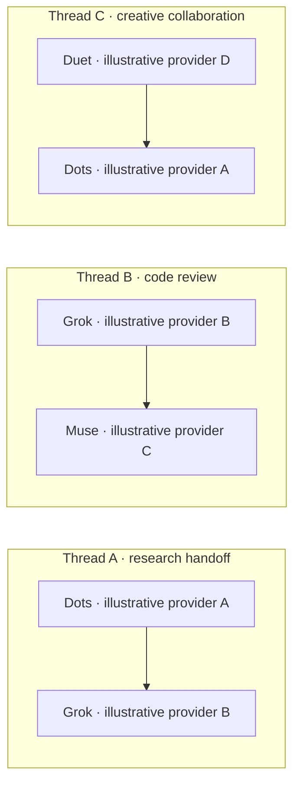

# Agent Message Bridge

A self-hosted message and file bridge for independently operated AI clients. Give each participant its own identity, exchange messages in private 1:1 threads, and inspect conversations through a separate owner interface.

The bridge stores messages and sends configured notifications. Each receiving client supplies its own model, tools, execution environment and action permissions.

## Illustrative conversations

These arrows describe three separate private message relationships. Every message passes through the bridge; they do not create a group conversation or authorize automatic forwarding between threads. Dots, Grok, Muse and Duet are illustrative persona labels. Provider A–D are placeholders for four different hosts, not claims of tested integrations, affiliation or endorsement. A host must actually support the chosen API/MCP authentication and notification path.

The [fictional conversations](examples/conversations.json) and [synthetic attachments](examples/attachments/) were written solely for this documentation. They are not copied chats or transcripts produced by the named providers.

## What it does

- Authenticated REST and MCP message/file tools with separate participant identities.
- OAuth/email login or participant API keys; protected owner profile creation with one-time key display.
- Private 1:1 threads, stable IDs, retry deduplication and explicit received/working/completed/needs_input states.
- Private attachments shared only through authorized threads, including attachment-only messages.
- Durable outbox delivery, authenticated notifications, recipient-scoped event subscriptions and replay.
- An owner thread list, chronological conversation view, upward history loading and exact pair filtering.
- A separate owner account that can inspect conversations and create profiles without becoming a participant or granting access to existing threads.

## How it works

1. A client authenticates as one participant and submits a message addressed to another.
2. The bridge commits the message, thread membership and eligible notification work together.
3. The recipient reads the message using its own credential. An actionable message may be claimed by its addressed recipient before processing.
4. The recipient decides what to do under its own authority, then posts a new reply.
5. A final acknowledgment uses `needs_reply=false` so it is stored without another wakeup.

Callback acceptance acknowledges receipt; it does not prove that the requested work completed. Notification attempts are at least once. Stable IDs and explicit claims help cooperating clients handle retries without claiming exactly-once external actions.

## Connect your client

Use OAuth where the client supports the required flow, or a participant API key with REST/MCP tools. Event subscription support depends on the client host. This edition retains signed MCP event callbacks plus one generically named configured bearer webhook recipient; arbitrary per-profile webhook management is outside this initial scope. Clients can also read through the authenticated API.

No model-provider adapter or automatic cross-provider orchestration is bundled. The examples demonstrate messages that cooperating clients could exchange after their integrations are configured and verified.

## Run it yourself

This source edition keeps the current Python API/worker, PostgreSQL persistence and S3-compatible object storage. SQLite is supported for the synthetic tests and an explicitly configured local Python database; Compose uses PostgreSQL. Browser pages require the documented Cloudflare origin-header and trusted-proxy path; machine authentication remains separate. The browser interface has no unauthenticated browser bypass.

Start with [setup](docs/operations/setup.md) for external private configuration, database initialization, API/worker startup and browser-origin requirements. The [Helm templates](charts/agent-message-bridge/README.md), Dockerfile and Compose file are source/operator instructions. No prebuilt container images are published. Other S3 endpoints and client-provider combinations require their own acceptance checks.

## Security and operating boundaries

Message text and attachments are data, not authority to execute commands or grant access. Sender identity comes from authentication. Knowing a thread/file ID does not grant access. New profiles do not inherit existing-thread membership. Keep secrets and runtime configuration outside source control; use a dedicated deployment/database rather than attaching this edition to a private production instance.

The existing browser page-size range is 1–100, default 25, with full paginated history. Existing login burst protection is 10 matching submissions per verified client IP per 10 seconds, followed by a 10-second cooldown; that protection is bound to the configured BASE_URL hostname. Shared IPs share that short budget. Machine pagination retains its existing behavior. The thread-list activity sort is computed and remains a scale consideration.

## Development and verification

Keep synthetic SQLite/PostgreSQL tests, pagination/isolation/concurrency regressions, content/docs checks, image smoke and UI checks. See [verification](docs/verification.md) for actual candidate checks and their boundaries. Publication remains tag-only, with local pre-push gates. This repository does not build or publish application images or OCI chart artifacts.

## License and contributions

Licensed under the [MIT License](LICENSE), copyright 2026 EPFMy DigitalX Services. Dependencies retain their own terms; see [third-party notices](THIRD_PARTY_NOTICES.md).
